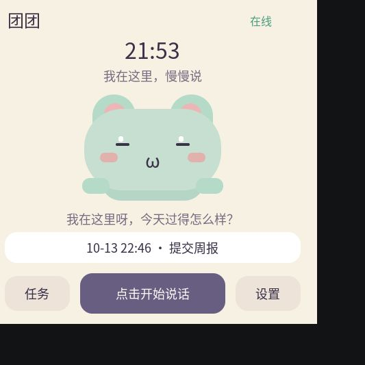

# 团团 Tuantuan · 桌面陪伴助手

让 ESP-Mosaico 成为可以对话、记录待办和按时提醒的桌面小伙伴。设备采用奶油色界面与薄荷色小猫形象，点击屏幕开始说话，再点一次结束。



- ESP-Mosaico V1.2.1 / ESP32-S31，480×480 触屏互动。
- 电脑端 Faster-Whisper ASR、DeepSeek 对话与中文 TTS。
- 待办、一次性及重复提醒，触屏完成、删除和稍后提醒。
- Token 和 API Key 使用本机 ENV 文件配置，仓库仅包含模板。

```sh
git clone --recurse-submodules https://github.com/jackyguo624/esp-mosaico-repo.git
cd esp-mosaico-repo/tuantuan/server
python3 -m venv .venv
.venv/bin/python -m pip install -r requirements-asr.txt
cp config.example.env config.env
# 编辑 config.env：填写 DEEPSEEK_API_KEY，设置随机 DEVICE_TOKEN
.venv/bin/python doctor.py
.venv/bin/python server.py --config config.env
```

固件使用固定的官方工作区依赖和 ESP-IDF 提交，安装步骤见项目说明。

- [完整项目说明](tuantuan/README.md)
- [首次连接](tuantuan/docs/getting-started.md)
- [配置模板](tuantuan/server/config.example.env)
- [固件包 1.0.1](tuantuan/firmware/tuantuan-1.0.1.irisfw)
- [服务端测试结果](tuantuan/docs/server-tests.txt)

`config.env`、`.env`、数据库、聊天记录、模型缓存和设备状态文件由 `.gitignore` 忽略。硬件 Wi-Fi 和设备连接口令在配网页面填写，运行时保存在设备 NVS 中。

仓库 CI 会运行服务端和配网地址回归测试，并检查已跟踪文件是否误包含真实 ENV 配置、运行数据或 API Key。提交前也可运行 `python3 scripts/check_private_files.py`。
